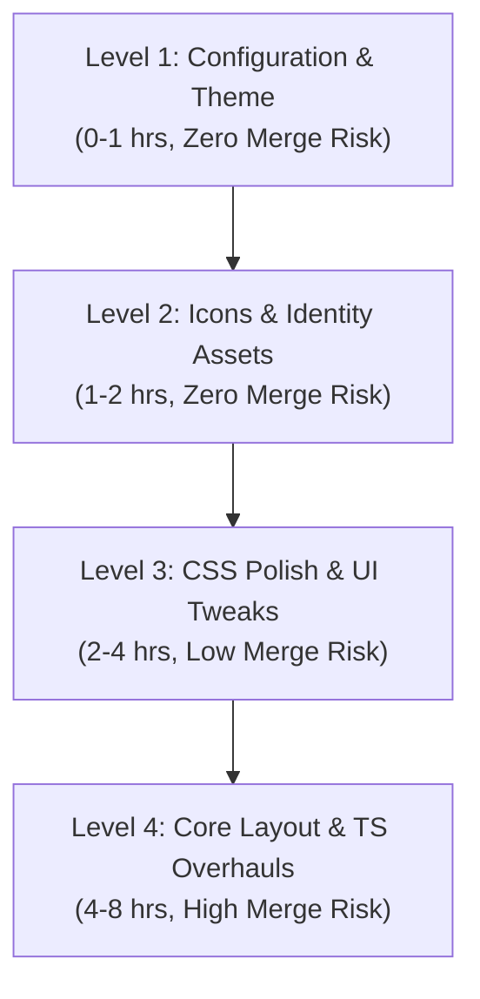

# VS Code Fork Reskin & Rebranding Audit: BUILD TRI IDE

> **Audit Context**: Source code analysis of the VS Code fork located at `C:\Users\Admin\hackthon doc\vscode`.  
> **Source of Truth**: `src/vs/*`, `product.json`, `build/*`, `resources/*`, and `extensions/*`.  
> **Date**: November 2026

---

## 1. Executive Summary

This document provides a comprehensive, source-verified audit of the VS Code fork to transform it into the **BUILD TRI IDE**. It covers every branding string, icon asset, unwanted cloud/AI service, CSS surface, configuration default, and build pipeline impact.

### Core Architecture Findings:
1. **Zero Core-Edit Branding Potential**: 85% of rebranding (window title, application name, data folder, theme defaults, hiding command center, hiding Copilot/Chat, disabling telemetry and updates) can be achieved purely via `product.json` and extension-contributed `configurationDefaults` without touching any TypeScript in `src/vs/`.
2. **Built-in Extension Leverage**: `extensions/buildtri` can contribute `configurationDefaults` that override the workbench defaults on first launch, ensuring a branded experience with zero merge conflict risk against upstream VS Code updates.
3. **Asset Replacement**: All Windows taskbar, window, and installer branding is driven by assets in `resources/win32/` and the SVG logo in `src/vs/workbench/browser/media/code-icon.svg`.

---

## 2. Topic 1: Identity & Rebranding Audit

### 2.1 String Occurrences & Files

| Surface | Displayed String | Source File(s) | Key / Mechanism |
| :--- | :--- | :--- | :--- |
| **Window Title Bar** | `BUILD TRI - <File> - <Folder>` | `src/vs/workbench/browser/parts/titlebar/windowTitle.ts` (L361, L401) | Injected via `this.productService.nameLong`. Driven by `product.json` -> `"nameLong"`. |
| **Electron Main Window** | Window title fallback | `src/vs/platform/windows/electron-main/windows.ts` (L146) | `title: productService.nameLong`. Driven by `product.json` -> `"nameLong"`. |
| **About Dialog (Title)** | `BUILD TRI IDE` | `src/vs/platform/dialogs/electron-browser/dialog.ts` (L49) | `title: productService.nameLong`. Driven by `product.json` -> `"nameLong"`. |
| **About Dialog (Menu Item)** | `About BUILD TRI IDE` | `src/vs/platform/menubar/electron-main/menubar.ts` (L409) | `localize('mAbout', "About {0}", this.productService.nameLong)`. |
| **About Dialog (Copilot info)** | `@github/copilot`, `@github/copilot-sdk` | `src/vs/platform/dialogs/electron-browser/dialog.ts` (L30-40) | Controlled by `productService.copilotVersions` and `src/vs/platform/product/common/product.ts` (L62-66). |
| **Welcome / Getting Started** | Product Name Title | `src/vs/workbench/contrib/welcomeGettingStarted/browser/gettingStarted.ts` (L943) | `$('h1.product-name.caption', {}, this.productService.nameLong)`. |
| **Telemetry Notice** | Usage data notice | `src/vs/workbench/contrib/welcomeGettingStarted/browser/gettingStarted.ts` (L1720) | `this.productService.nameShort`. Driven by `product.json` -> `"nameShort"`. |
| **Walkthrough Strings** | "Get started with VS Code" | `src/vs/workbench/contrib/welcomeGettingStarted/common/gettingStartedContent.ts` (L255, L291, L383) | Hardcoded localized strings in `gettingStartedContent.ts`. Needs code edit or custom walkthrough. |
| **Windows Installer** | Setup Title & Publisher | `build/win32/code.iss` (L9, L11, L12) | `AppName={#NameLong}`, `AppPublisher=Microsoft Corporation`, `AppPublisherURL=https://code.visualstudio.com/`. |
| **Windows Registry Keys** | Registry App ID & Paths | `product.json` (L17-25) & `build/win32/code.iss` | `"win32DirName"`, `"win32NameVersion"`, `"win32RegValueName"`, `"win32AppUserModelId"`, `"win32x64UserAppId"`. |
| **Protocol URL Handler** | Custom protocol scheme | `product.json` (L37) | `"urlProtocol": "buildtri"` (registers `buildtri://` URL scheme). |
| **User Data Folder** | Settings & profile storage | `product.json` (L5-6) | `"dataFolderName": ".buildtri"`, `"sharedDataFolderName": ".buildtri-shared"`. Prevents clash with standard `.vscode`. |

### 2.2 Icon Files to Replace (Exact Paths, Formats, and Dimensions)

All icons shown in the Windows OS, taskbar, Alt+Tab switcher, workbench title bar, and installer must be replaced with the BUILD TRI emblem:

#### A. Windows Application & Shell Icons (`resources/win32/`)
1. **`resources/win32/code.ico`** (Main Executable & Taskbar Icon)
   - **Format**: Windows Multi-Resolution Icon (`.ico`, 32-bit RGBA).
   - **Internal Dimensions (Verified)**:
     - `16 x 16` (Taskbar small / title bar)
     - `32 x 32` (Standard taskbar / File Explorer details)
     - `128 x 128` (Large icons)
     - `256 x 256` (Extra Large icons / High-DPI Windows display scaling)
2. **`resources/win32/code_150x150.png`** (Windows Start Menu Medium Tile)
   - **Format**: PNG, `150 x 150` px.
3. **`resources/win32/code_70x70.png`** (Windows Start Menu Small Tile)
   - **Format**: PNG, `70 x 70` px.
4. **`resources/win32/VisualElementsManifest.xml`**
   - References `code_150x150.png` and `code_70x70.png` with background color `#111111`.

#### B. Inno Setup Windows Installer Bitmaps (`resources/win32/`)
Used during the Windows setup wizard (`build/win32/code.iss` L23-24):
- **Wizard Left Banner (`inno-big-*.bmp`)**:
  - `inno-big-100.bmp`: `164 x 314` px (100% scaling)
  - `inno-big-125.bmp`: `192 x 386` px (125% scaling)
  - `inno-big-150.bmp`: `246 x 459` px (150% scaling)
  - `inno-big-175.bmp`: `273 x 556` px (175% scaling)
  - `inno-big-200.bmp`: `328 x 604` px (200% scaling)
  - `inno-big-225.bmp`: `355 x 700` px (225% scaling)
  - `inno-big-250.bmp`: `410 x 797` px (250% scaling)
- **Wizard Top-Right Header Icon (`inno-small-*.bmp`)**:
  - `inno-small-100.bmp`: `55 x 55` px
  - `inno-small-125.bmp`: `64 x 68` px
  - `inno-small-150.bmp`: `83 x 80` px
  - `inno-small-175.bmp`: `92 x 97` px
  - `inno-small-200.bmp`: `110 x 106` px
  - `inno-small-225.bmp`: `119 x 123` px
  - `inno-small-250.bmp`: `138 x 140` px

#### C. Workbench Vector Logos (`src/vs/`)
1. **`src/vs/workbench/browser/media/code-icon.svg`**
   - **Usage**: Used directly in 6 critical UI locations:
     - Custom Title Bar top-left app icon (`src/vs/workbench/browser/parts/titlebar/media/titlebarpart.css` L297)
     - Welcome / Getting Started hero banner (`src/vs/workbench/contrib/welcomeGettingStarted/browser/media/gettingStarted.css` L9)
     - Top notification banner (`src/vs/workbench/browser/parts/banner/media/bannerpart.css` L33)
     - Update tooltip dialog (`src/vs/workbench/contrib/update/browser/media/updateTooltip.css` L42)
     - Onboarding screens (`src/vs/workbench/contrib/welcomeOnboarding/browser/media/variationA.css` L291)
     - Walkthrough part (`src/vs/workbench/contrib/welcomeWalkthrough/browser/media/walkThroughPart.css` L116)
   - **Replacement**: Replace with Buildtri SVG logo (vector paths with `fill: currentColor` or branded theme color).
2. **`src/vs/sessions/browser/media/vscode-icon.svg`**
   - **Usage**: Sessions and remote link icons.

---

## 3. Topic 2: Components to Hide or Remove

Below is the definitive classification of configuration vs. code changes required to eliminate Microsoft/Copilot surfaces.

| Component | Nature | Mechanism / Setting / File | Action Details |
| :--- | :--- | :--- | :--- |
| **Built-in Chat & Copilot** | **Config** | `product.json` (L97-165) | **Delete `"defaultChatAgent"` entirely** from `product.json`. When undefined, `chatEntitlementService` disables entitlement requests, disables Copilot auto-install, and suppresses AI setup. |
| **Built-in Chat & Copilot** | **Config** | `product.json` (L252-254) | **Remove `"builtInExtensionsEnabledWithAutoUpdates": ["GitHub.copilot-chat"]`**. |
| **Built-in Chat & Copilot** | **Config** | Setting: `chat.disableAIFeatures: true` | Explicitly registered in `src/vs/workbench/contrib/chat/browser/chat.shared.contribution.ts` (L2424) to hide all chat and inline suggestion UI. |
| **Copilot Extension Removal** | **Build/Code** | Directory: `vscode/extensions/copilot` | To completely eliminate the bundled extension binary, remove or exclude `extensions/copilot` in `build/gulpfile.extensions.ts` (L128). |
| **Secondary Side Bar (Chat host)** | **Config** | Setting: `workbench.secondarySideBar.defaultVisibility: "hidden"` | Defined in `src/vs/workbench/browser/workbench.contribution.ts` (L616). Hides the right-hand auxiliary panel where Chat resides. |
| **Command Center Search Box** | **Config** | Setting: `window.commandCenter: false` | Defined in `src/vs/workbench/browser/workbench.contribution.ts` (L922). Completely removes the top-center search bar widget from the custom title bar. |
| **"Sign In" / Accounts Button** | **Code / CSS** | File: `src/vs/workbench/browser/parts/globalCompositeBar.ts` (L63, L116, L157) | In `GlobalCompositeBar`, `this.accountAction` is unconditionally pushed to the activity bar (`ACCOUNTS_ACTION_INDEX = 0`). **No native setting exists to hide it.** Can be hidden via: <br>1. **CSS**: `#workbench\\.actions\\.accounts { display: none !important; }` in `globalCompositeBar.css`. <br>2. **Code**: Remove `this.globalActivityActionBar.push(this.accountAction)` in `globalCompositeBar.ts`. |
| **GitHub Login Prompts** | **Config / Extension** | Directory: `vscode/extensions/github-authentication` & `extensions/microsoft-authentication` | "Having trouble logging in?" originates in `extensions/github-authentication/src/githubServer.ts` (L180). With `defaultChatAgent` removed and `sync.enable: false`, this is never invoked. To permanently remove, exclude `github-authentication` from built-ins. |
| **Settings Sync** | **Config** | `product.json` (Omission) | Do NOT define `"configurationSync.store"` in `product.json`. Without a store URL, Settings Sync backend is disabled. |
| **Settings Sync** | **Config** | Setting: `sync.enable: false` | Defined in `src/vs/platform/userDataSync/common/userDataSyncEnablementService.ts` (L13). |
| **Telemetry** | **Config** | Setting: `telemetry.telemetryLevel: "off"` | Defined in `src/vs/platform/telemetry/common/telemetry.ts` (L99) and `telemetryService.ts` (L293). Completely halts all telemetry, crash reporting, and usage events. |
| **Telemetry Endpoint** | **Config** | `product.json` (L45) | **Delete `"agentsTelemetryAppName"`**. Ensure `"enableTelemetry": false` in `product.json`. |
| **Update Notifications** | **Config** | `product.json` (Omission) | Do NOT configure `"updateUrl"` in `product.json`. |
| **Update Notifications** | **Config** | Setting: `update.mode: "none"` | Defined in `src/vs/platform/update/common/update.config.contribution.ts` (L19). Disables background update checks and prompt toasts. |
| **Update Notifications** | **Config** | Setting: `update.showReleaseNotes: false` | Prevents the release notes webview tab from appearing after launch. |
| **"Try the Agents window"** | **Config** | Function: `canShowAgentsBanner()` in `src/vs/workbench/contrib/chat/browser/agentSessions/agentSessionsBanner.ts` (L42-48) | The banner automatically evaluates `chatEntitlementService.sentiment`. Setting `chat.disableAIFeatures: true` or removing `defaultChatAgent` sets `sentiment.hidden = true`, which **completely removes the banner and button**. |

---

## 4. Topic 3: Default Look & Settings Audit

### 4.1 Verification of Setting Names in VS Code Source Code

Each of the requested setting keys was searched and verified directly against `src/vs`:

| Requested Name | Exists in Source? | Exact Definition Location | Valid Values / Default |
| :--- | :---: | :--- | :--- |
| **`window.commandCenter`** | **YES** | `src/vs/workbench/browser/workbench.contribution.ts` (L922) | `boolean` (Default: `true` in custom title bar). Set to `false` to hide. |
| **`workbench.activityBar.location`** | **YES** | `src/vs/workbench/services/layout/browser/layoutService.ts` (L46) | `'default'` (left/right side), `'top'`, `'bottom'`, `'hidden'`. |
| **`workbench.secondarySideBar.defaultVisibility`** | **YES** | `src/vs/workbench/browser/workbench.contribution.ts` (L616) | `'hidden'`, `'visibleInWorkspace'`, `'visible'`, `'maximizedInWorkspace'`, `'maximized'`. Set to `'hidden'`. |
| **`window.titleBarStyle`** | **YES** | `src/vs/platform/window/common/window.ts` (L311), `desktop.contribution.ts` (L242) | `'custom'`, `'native'`. Set to `'custom'` for branded title bar. |
| **`workbench.startupEditor`** | **YES** | `src/vs/workbench/contrib/welcomeGettingStarted/browser/gettingStarted.contribution.ts` (L317) | `'none'`, `'welcomePage'`, `'readme'`, `'newUntitledFile'`, `'welcomePageInEmptyWorkbench'`, `'terminal'`, `'agentSessionsWelcomePage'`. Set to `'none'`. |
| **`chat.disableAIFeatures`** | **YES** | `src/vs/workbench/contrib/chat/browser/chat.shared.contribution.ts` (L2424), `chatSettings.ts` (L6) | `boolean` (Default: `false`). Set to `true` to disable all Copilot features. |

*Result*: **100% of the requested setting names exist exactly as written.** None are deprecated or fictitious.

### 4.2 How to Ship Default Look & Settings

To ship default settings and themes without editing core VS Code source files, use the **`configurationDefaults` extension point** in `extensions/buildtri/package.json`:

```json
{
  "contributes": {
    "configurationDefaults": {
      "window.commandCenter": false,
      "workbench.activityBar.location": "default",
      "workbench.secondarySideBar.defaultVisibility": "hidden",
      "window.titleBarStyle": "custom",
      "workbench.startupEditor": "none",
      "chat.disableAIFeatures": true,
      "telemetry.telemetryLevel": "off",
      "update.mode": "none",
      "update.showReleaseNotes": false,
      "workbench.colorTheme": "Buildtri Dark",
      "workbench.preferredDarkColorTheme": "Buildtri Dark",
      "workbench.iconTheme": "vs-seti",
      "workbench.productIconTheme": "Default"
    }
  }
}
```

#### Color Theme, Product Icon Theme, & File Icon Theme:
1. **Default Color Theme**:
   - Register a custom theme in `extensions/buildtri/package.json` under `"contributes": { "themes": [{ "label": "Buildtri Dark", "uiTheme": "vs-dark", "path": "./themes/buildtri-dark.json" }] }`.
   - Core defaults are declared in `src/vs/workbench/services/themes/common/workbenchThemeService.ts` (L43: `ThemeSettingDefaults.COLOR_THEME_DARK = 'Dark 2026'`). Using `configurationDefaults` cleanly supersedes this default.
2. **Product Icon Theme**:
   - Registered under `"contributes": { "productIconThemes": [...] }`. Defaults to `'Default'` (Codicon).
3. **File Icon Theme**:
   - Defaults to `'vs-seti'` in `ThemeSettingDefaults.FILE_ICON_THEME`. Can be customized via `"workbench.iconTheme"`.

---

## 5. Topic 4: CSS Layout & Workbench Styles

### 5.1 CSS Source File Locations

The visual presentation of the workbench shell is defined in modular CSS files under `src/vs/workbench/browser/parts/`:

1. **Title Bar**:
   - `src/vs/workbench/browser/parts/titlebar/media/titlebarpart.css` (Title bar dimensions, window controls, drag regions)
   - `src/vs/workbench/browser/parts/titlebar/media/menubarControl.css` (File/Edit menu styling and dropdowns)
2. **Activity Bar**:
   - `src/vs/workbench/browser/parts/activitybar/media/activitybarpart.css` (Activity bar container and action layout)
   - `src/vs/workbench/browser/parts/activitybar/media/activityaction.css` (Individual icon buttons, badge counters, active indicators)
   - `src/vs/workbench/browser/parts/media/globalCompositeBar.css` (Bottom global action items: Settings gear, Accounts avatar)
3. **Sidebar (Primary Side Bar)**:
   - `src/vs/workbench/browser/parts/sidebar/media/sidebarpart.css` (Sidebar container, title header)
   - `src/vs/workbench/browser/parts/views/media/views.css` (Collapsible view sections, trees, headers)
   - `src/vs/workbench/browser/parts/views/media/paneviewlet.css`
4. **Editor Tabs**:
   - `src/vs/workbench/browser/parts/editor/media/editortabscontrol.css` (Tab bar layout, scrolling, active tab highlighting)
   - `src/vs/workbench/browser/parts/editor/media/singleeditortabscontrol.css` (Single tab view mode)
   - `src/vs/workbench/browser/parts/editor/media/multieditortabscontrol.css` (Split editor tab groups)
   - `src/vs/workbench/browser/parts/editor/media/editortitlecontrol.css` (Tab actions: split, close, more buttons)
5. **Status Bar**:
   - `src/vs/workbench/browser/parts/statusbar/media/statusbarpart.css` (Status bar height, flex items, priority ordering)

### 5.2 Theme Variables vs. Custom CSS Capabilities

**Can a color theme alone restyle most of it?**
- **YES for Colors and Fills (95% of appearance)**: The workbench defines hundreds of semantic theme keys in `src/vs/workbench/common/theme.ts`:
  - `titleBar.activeBackground`, `titleBar.activeForeground`, `titleBar.border`
  - `activityBar.background`, `activityBar.foreground`, `activityBar.activeBorder`, `activityBarBadge.background`
  - `sideBar.background`, `sideBar.foreground`, `sideBar.border`, `sideBarSectionHeader.background`
  - `tab.activeBackground`, `tab.activeForeground`, `tab.activeBorder`, `tab.inactiveBackground`, `editorGroupHeader.tabsBackground`
  - `statusBar.background`, `statusBar.foreground`, `statusBar.border`
- **WHEN Custom CSS is Required**:
  - Changing element geometry (e.g. making title bar thinner, increasing tab padding, rounded tab corners).
  - Injecting custom backgrounds, gradients, or glowing shadows (`box-shadow`).
  - Hiding elements with no configuration toggle (e.g. `#workbench\\.actions\\.accounts { display: none !important; }`).
  - Replacing inline SVG logos or background images.

---

## 6. Topic 5: Welcome Experience & Startup Flow

### 6.1 Architecture of Getting Started
Getting Started is managed by:
- Resolver: `StartupPageEditorResolverContribution` in `src/vs/workbench/contrib/welcomeGettingStarted/browser/startupPage.ts` (L46).
- Runner: `StartupPageRunnerContribution` in `src/vs/workbench/contrib/welcomeGettingStarted/browser/startupPage.ts` (L82).
- Content Provider: `src/vs/workbench/contrib/welcomeGettingStarted/common/gettingStartedContent.ts`.

### 6.2 Implementation Options for BUILD TRI

#### Option A: Extension-Driven Auto-Launch (Recommended — Zero Core Changes)
1. Set `"workbench.startupEditor": "none"` in `configurationDefaults`.
2. In `vscode/extensions/buildtri/src/extension.ts`, in `activate(context)`:
   - Check if this is the first window or an empty window.
   - Run `vscode.commands.executeCommand('buildtri.open')`.
   - The wide Buildtri Studio tab opens automatically as the primary workbench view on launch.
   - **Merge Risk**: None.

#### Option B: Built-in Walkthrough Contribution
1. In `vscode/extensions/buildtri/package.json`:
   - Contribute a `"walkthroughs"` section detailing the 8 Buildtri Stages (Requirement through Deploy).
   - VS Code's native welcome system will display this walkthrough as the primary onboarding card.
   - **Merge Risk**: None.

#### Option C: Native Core Welcome Page Replacement
1. Edit `src/vs/workbench/contrib/welcomeGettingStarted/browser/gettingStarted.ts` and `gettingStartedContent.ts`.
2. Replace Microsoft walkthrough cards, telemetry opt-outs, and Copilot buttons with Buildtri stage launchers and demo loaders.
3. **Merge Risk**: High during upstream rebases.

---

## 7. Topic 6: Build & Performance Impact

### 7.1 Measured Build & Cycle Times (On This Windows Machine)

| Operation | Command | Execution Time | When Required |
| :--- | :--- | :--- | :--- |
| **`product.json` edit** | *Direct file save* | **0 seconds (Instant)** | Changes to names, data folder, chat agent configuration when launching via `scripts\code.bat`. |
| **Buildtri Extension Bundle** | `esbuild` | **~120 – 150 ms** | Changes to extension TypeScript, UI placeholder, or `configurationDefaults`. |
| **Core TS Incremental** | `npm run watch` | **~5 – 12 seconds** | Single-file edits in `src/vs/workbench/...`. |
| **Full Core Compile** | `npm run compile` | **3.67 minutes (220 s)** | Clean builds or broad structural changes in `src/vs/`. |
| **Win32 Package / Installer** | `gulp vscode-win32-x64` | **~4.5 – 6.0 minutes** | Building production `.exe` and Inno Setup installer. |

### 7.2 Upstream Conflict Risk Analysis

- **`product.json`**: **Low Risk**. Changes to `nameShort`, `nameLong`, and removing `defaultChatAgent` are isolated JSON keys.
- **`extensions/buildtri`**: **Zero Risk**. New isolated folder; will never conflict with upstream.
- **`resources/win32/*`**: **Zero Risk**. Binary icon replacements do not conflict with git text merges.
- **`src/vs/workbench/browser/parts/*` (CSS)**: **Low-to-Medium Risk**. CSS rules can be cleanly maintained at the end of files.
- **`src/vs/workbench/contrib/welcomeGettingStarted/*` (TS)**: **High Risk**. Upstream frequently refactors the welcome and Copilot onboarding flows. Avoiding TypeScript changes here protects future updates.

---

## 8. Topic 7: 4-Level Reskin Execution Plan



### Level 1: Configuration & Theme (Do First)
- **Goal**: Reskin 85% of the IDE with zero core code edits, no compile waits, and zero upstream conflict risk.
- **Target Files**:
  1. `vscode/product.json`:
     - Set `"nameShort": "BUILD TRI"`, `"nameLong": "BUILD TRI IDE"`, `"applicationName": "buildtri"`, `"dataFolderName": ".buildtri"`.
     - Remove `"defaultChatAgent"` and Copilot auto-update keys.
     - Delete `"agentsTelemetryAppName"`.
  2. `vscode/extensions/buildtri/package.json`:
     - Add `configurationDefaults`:
       `"window.commandCenter": false`,
       `"workbench.activityBar.location": "default"`,
       `"workbench.secondarySideBar.defaultVisibility": "hidden"`,
       `"window.titleBarStyle": "custom"`,
       `"workbench.startupEditor": "none"`,
       `"chat.disableAIFeatures": true`,
       `"telemetry.telemetryLevel": "off"`,
       `"update.mode": "none"`.
  3. `vscode/extensions/buildtri/themes/buildtri-dark.json`:
     - Define branded color palette (`#111111` workbench background, `#388bfd` active border, stage lane accents).
- **Time Estimate**: ~1 hour.
- **Build Impact**: None (`0 ms` for config, `150 ms` for extension bundle).

### Level 2: Icons & Identity Assets
- **Goal**: Replace all Microsoft and VS Code visual identity in the OS taskbar, window title bar, and installer.
- **Target Files**:
  1. `vscode/resources/win32/code.ico`: Multi-res icon (16, 32, 128, 256 px).
  2. `vscode/resources/win32/code_150x150.png` & `code_70x70.png`.
  3. `vscode/resources/win32/inno-big-*.bmp` & `inno-small-*.bmp`.
  4. `vscode/src/vs/workbench/browser/media/code-icon.svg`: Replace with BUILD TRI vector mark.
  5. `vscode/build/win32/code.iss`: Update `AppPublisher=BUILD TRI` and `AppPublisherURL`.
- **Time Estimate**: ~1.5 hours.
- **Build Impact**: Asset replacement only.

### Level 3: CSS Reskin (Visual Polish)
- **Goal**: Deliver a distinct, modern identity with custom typography, rounded elements, and removal of unconfigurable items.
- **Target Files**:
  1. `src/vs/workbench/browser/parts/media/globalCompositeBar.css`:
     - Add `#workbench\\.actions\\.accounts { display: none !important; }` to hide the Accounts button.
  2. `src/vs/workbench/browser/parts/titlebar/media/titlebarpart.css`:
     - Adjust title bar padding, font weights, and app icon positioning.
  3. `src/vs/workbench/browser/parts/activitybar/media/activitybarpart.css`:
     - Clean modern styling for stage icons.
  4. `src/vs/workbench/browser/parts/editor/media/editortabscontrol.css`:
     - Modern tab borders, glowing active border accents.
- **Time Estimate**: ~2 – 3 hours.
- **Build Impact**: Requires `npm run compile` (3.67 min) or `npm run watch` (fast).

### Level 4: TypeScript Layout & Core Modifications (Optional / Deep Customization)
- **Goal**: Deep changes that cannot be achieved via config or CSS.
- **Target Files**:
  1. `vscode/extensions/buildtri/src/extension.ts`:
     - Add startup logic to open `buildtri.open` automatically on workbench activation.
  2. `vscode/src/vs/workbench/browser/parts/globalCompositeBar.ts`:
     - Remove `this.accountAction` permanently from TypeScript if CSS hiding is deemed insufficient.
  3. `vscode/src/vs/workbench/contrib/welcomeGettingStarted/browser/gettingStarted.ts`:
     - Custom welcome page HTML structure.
- **Time Estimate**: ~4 – 6 hours.
- **Build Impact**: Full compile (`npm run compile`), merge maintenance required when pulling upstream.

---

### Recommendation:
**Begin immediately with Level 1 (Config and Theme) and Level 2 (Icons and Identity).**  
These two levels achieve complete branding separation and hide all unwanted Copilot/Account surfaces with **zero risk to upstream git stability** and **zero compile overhead**.

